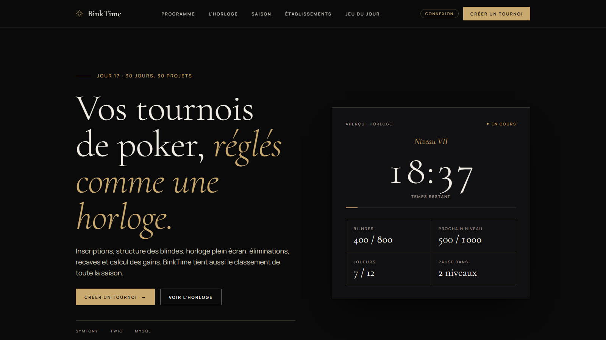

# BinkTime · Vos tournois de poker, réglés comme une horloge

> Jour 17 du défi **30 jours, 30 projets** · Symfony · Twig · MySQL · **https://binktime.projectp.fr**



Un gestionnaire de tournois de poker entre amis ou en club : inscriptions, structure des blindes, **horloge** plein écran pilotée depuis un téléphone, éliminations, recaves et calcul des gains. **BinkTime** tient aussi le classement de la saison.

📄 Les règles détaillées sont dans le [cahier des charges](CAHIER_DES_CHARGES.md) ; les maquettes et la charte « Noir & Or » dans [`docs/maquettes`](docs/maquettes).

## Ce que ça fait

- **Tournoi à la maison, sans compte** : on crée le tournoi (buy-in, recave, add-on, structure Turbo, Classique ou Deep stack, répartition des gains) et on reçoit un **lien secret** pour le piloter.
- **Pilotage** : inscriptions (même tardives), recaves, add-ons, éliminations dans l'ordre, annulation de la dernière élimination. Le vainqueur est déclaré quand il ne reste qu'un joueur.
- **Gains** : 50 / 30 / 20 par défaut, modifiables, arrondis à l'euro ; le reste de l'arrondi va au vainqueur, la somme des gains vaut toujours la cagnotte.
- **Horloge plein écran** pour la télé (lien public, lecture seule) et **télécommande** sur le téléphone : niveau, temps, blindes et ante, prochain niveau, joueurs restants, tapis moyen, prize pool. Son à chaque changement de niveau, écran maintenu allumé. L'état est gardé sur le serveur : après un rechargement, l'horloge reprend au bon niveau.
- **Comptes établissements** (bar, club, cercle) : saisons, tournois, page publique avec les tournois à l'affiche, l'horloge en direct et le **classement de saison** (points = joueurs − place + 1, doublés dans l'argent), recalculé à chaque tournoi terminé.
- **Jeu du jour, « Compte du tapis »** : un tapis de jetons s'affiche 6 secondes, on retrouve son total en 4 essais avec indice plus/moins. Le même tapis pour tout le monde (tiré d'après la date, heure de Paris), série 🔥 et résultat à partager.

## Lancer en local

PHP 8.4 et Composer suffisent : en local, la base est un fichier **SQLite** (`var/data_dev.db`), rien à installer.

```bash
composer install
php bin/console doctrine:migrations:migrate
php bin/console doctrine:fixtures:load   # établissement de démo + un tournoi à la maison
symfony serve -d                         # http://127.0.0.1:8000
```

Le compte organisateur de démo (local uniquement) est dans [`src/DataFixtures/AppFixtures.php`](src/DataFixtures/AppFixtures.php).

```bash
php bin/phpunit   # gains, points, horloge, tirage du jeu, parcours des comptes
```

## Mise en ligne

BinkTime tourne sur un VPS géré avec **[Coolify](https://coolify.io)**, comme Kairos (jour 5).

```
git push (main) ──► Coolify : nouvelle image ──► migrations ──► site à jour
                └─► GitHub Actions : tests sur MySQL 8.4 + construction de l'image Docker
```

L'image (`Dockerfile`) repose sur **FrankenPHP** (Caddy + PHP 8.4) ; Coolify (Traefik) s'occupe du HTTPS. Au démarrage, `docker/entrypoint.sh` attend MySQL, lance les migrations et prépare le cache.

1. **Base** : *+ New → Database → MySQL* (8.4), noter l'URL interne.
2. **Application** : *+ New → Repository* → `PierreWZK/binktime`, branche `main`, **Build Pack : Dockerfile**, port **80**, domaine `https://binktime.projectp.fr` (DNS `A` de `binktime` vers le VPS), healthcheck `/`, déploiement automatique à chaque push.
3. **Volume** : `binktime-share` monté sur `/app/var/share` (sessions des organisateurs, limites de connexion).
4. **Variables d'environnement** (jamais versionnées) :

| Variable | Valeur |
| --- | --- |
| `APP_SECRET` | une chaîne aléatoire de 32 caractères ou plus (`openssl rand -hex 32`) |
| `DATABASE_URL` | l'URL interne de l'étape 1, suivie de `?serverVersion=8.4.0&charset=utf8mb4` |
| `DEFAULT_URI` | `https://binktime.projectp.fr` |

`APP_ENV=prod` et `TRUSTED_PROXIES=private_ranges` sont fixés par l'image.

5. **Démo** : après le premier déploiement, dans le terminal du conteneur, `php bin/console app:demo:reset` (l'établissement « Le Cercle du Losange », son mot de passe est aléatoire et jamais affiché). Puis une tâche planifiée `demo-reset`, même commande, `0 4 * * *`, pour que le tournoi en cours de la démo reparte chaque nuit.

## Stack

Symfony 7.4 LTS · Twig · AssetMapper (sans build front) · Doctrine (SQLite en local, MySQL en production) · PHPUnit · FrankenPHP · Coolify.

## Avant de déclarer le projet terminé

> Rappel pour Claude : à faire sur chaque projet, sans que je le redemande (détail dans les sections 9 et 10 du cahier des charges).

- **Indexation** : `robots.txt`, `sitemap.xml`, balise canonical, données structurées JSON-LD (`WebApplication` rattachée à ProjectP) et lien « 30 jours, 30 projets » vers https://projectp.fr/ dans le pied de page. Vérifier en ligne, puis me rappeler de soumettre `https://binktime.projectp.fr/sitemap.xml` dans Google Search Console.
- **Aperçu du lien** : image Open Graph stylisée 1200 × 630 aux couleurs du projet et balises `og:*` / `twitter:card`, vérifiées en ligne.
- **Vitrine** : la mise à jour de `30days30projects` (README et `projects.js`) se fait **après ma validation**.
